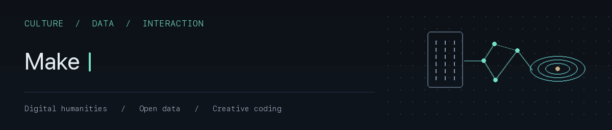
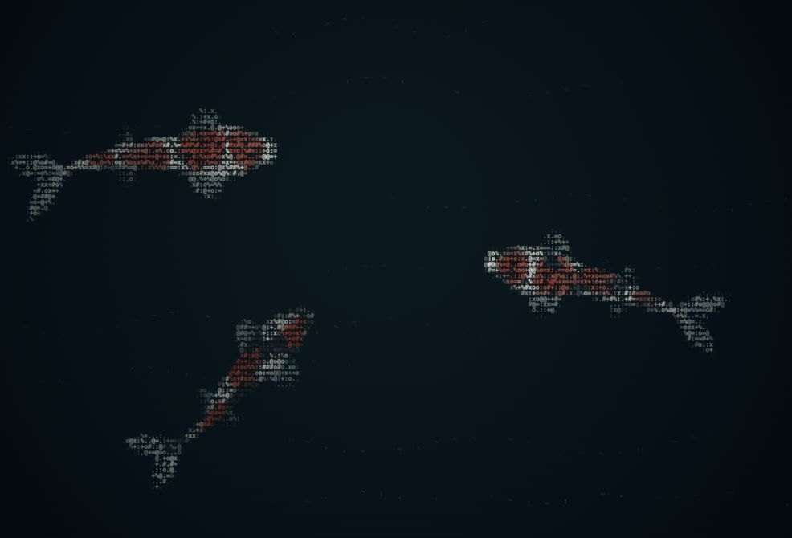

# Chen-Yu Chu · 曲宸宇

<picture>
  <source media="(prefers-reduced-motion: reduce)" srcset="assets/focus-static.png">
  
</picture>

I explore **cultural heritage, open data, and creative coding**—turning source material and ideas into things people can read, use, and build on, with AI as a collaborator.

我探索 **文化材料、開放資料與互動創作**，透過 AI 協作將原始資料與想法做成他人可以閱讀、使用與延伸的作品。

[一卦 Yigua](https://yigua.art/) · [ORCID](https://orcid.org/0009-0003-9738-6914) · [All projects｜全部專案](https://github.com/poplolioi11?tab=repositories)

## Current focus｜目前方向

- **Digital humanities｜數位人文** — Traceable historical-text datasets. 整理可追溯的古籍文字，保留底本來源、疑讀與修訂紀錄。
- **Open cultural data｜文化開放資料** — Source-linked library and museum records from Taiwan. 整合臺灣圖書館統計與博物館保存修護公開資料，提供可用資料與回查入口。
- **Creative coding｜互動視覺創作** — Water, creatures, ASCII, and cultural experiences in the browser. 探索水景、生物與字元動畫，並透過「一卦」製作文化互動體驗。
- **AI collaboration｜AI 協作** — Experiments in background delegation, result collection, and review. 實驗背景派工、成果回收與查核整合，減少工具之間的手動搬運。

## Selected work｜代表作品

Two small worlds, ready to explore in your browser.｜兩個可以直接開啟的水中世界。

**[Rain Lake｜雨湖](https://github.com/poplolioi11/rain-lake)** — Rain, ripples, and quiet fish shadows.｜細雨、漣漪與緩慢游動的魚影。 
[Smooth demo](https://poplolioi11.github.io/rain-lake/smooth/) · [ASCII demo](https://poplolioi11.github.io/rain-lake/ascii/)

**[Gosanke Koi｜御三家錦鯉](https://github.com/poplolioi11/gosanke-koi)** — Three ASCII koi moving through a dark pond.｜三隻字元錦鯉在深墨藍水域悠游。 
[Live demo｜直接試看](https://poplolioi11.github.io/gosanke-koi/)

| Project｜專案 | Why explore it?｜可以看什麼？ |
| --- | --- |
| [Taiwan Public Library Statistics｜臺灣公共圖書館統計](https://github.com/poplolioi11/tw-public-library-statistics) | Explore charts and CSV/SQLite datasets traceable to official sources. 查閱圖表與 CSV／SQLite 資料，逐筆回官方來源。 [Open explorer｜開啟圖表](https://poplolioi11.github.io/tw-public-library-statistics/) |
| [Taiwan Public Museum Conservation Index｜臺灣公立館保存修護索引](https://github.com/poplolioi11/tw-public-museum-conservation) | Find published conservation records with source and coverage notes. 查找保存修護公開紀錄，保留來源、涵蓋範圍與缺口。 |
| [Sitian Kaoyantu｜司天考驗圖](https://github.com/poplolioi11/ms-chin-c25-sitian-kaoyantu) | An AI-assisted draft transcription with image review, uncertain readings, and versioned files. 古籍 AI 輔助初錄與回圖校讀，保留疑讀與版本紀錄。 |
| [AI Coop](https://github.com/poplolioi11/ai-coop) | An experimental bridge for background AI delegation and result collection. 實驗性的背景 AI 派工與成果回收橋接工具。 |

More cultural projects｜更多文化作品

- [Yigua｜一卦](https://yigua.art/) — An I Ching experience rooted in hexagrams and source texts.｜以卦象與原典為核心的《易經》數位體驗。
- [Yigua Minecraft｜一卦 Minecraft](https://github.com/poplolioi11/yigua-minecraft) — Exploring cultural interaction in a game world.｜探索遊戲中的文化互動。
- [Wuyingdian I Ching lines｜武英殿本《周易》爻辭](https://github.com/poplolioi11/yigua-wuyingdian-lines)
- [Lunyu Xiangdang Tujie｜論語郷黨圖解](https://github.com/poplolioi11/kyoto-rb00009915-lunyu-xiangdang-tujie-1812)

## How I work｜我怎麼做

**Human-led direction, AI-assisted research and implementation.** I focus on defining problems, making editorial and design decisions, and reviewing and integrating results. Sources, versions, and limitations stay visible.

**由人決定方向，透過 AI 協助研究與實作。** 我著重問題定義、內容與美術取捨，以及成果判斷和整合，並保留來源、版本與尚待驗證的部分。

Historical-text projects include AI-assisted drafts and image-based review; they are **not human expert-verified editions**. Data coverage, rights, and validation are documented per project.

古籍專案包含 AI 輔助初錄與回圖校讀，**尚非人類專家審定本**；資料涵蓋範圍、權利與驗證狀態，均以各專案說明為準。

Community notes & certification｜社群紀錄與認證

I also document reproducible Traditional Chinese / CJK interface issues, including [Carbon’s translated labels](https://github.com/carbon-design-system/carbon/issues/23846) and [Adobe Spectrum’s locale-sensitive line height](https://github.com/adobe/spectrum-web-components/issues/6861). These links record issue reports; resolution status belongs to each upstream project.

我也整理繁體中文與 CJK 介面中可重現的問題，包括 [Carbon 翻譯標籤](https://github.com/carbon-design-system/carbon/issues/23846)與 [Adobe Spectrum 語系行高](https://github.com/adobe/spectrum-web-components/issues/6861)；這些連結為問題回報，修正狀態以各上游專案為準。

| Certification｜認證 | Issuer｜核發單位 | Issued｜取得日期 | Valid until｜有效期限 |
| --- | --- | --- | --- |
| [Gemini Certified University Student](https://edu.google.accredible.com/89146706-ac8b-448e-8b65-49f61c4e0b6f) | Google for Education | 2026-10-24 | 2029-10-24 |

If a project is useful to you, a star helps you find it again. Feedback and thoughtful adaptations are welcome. 
若作品對你有幫助，歡迎加星收藏，也歡迎回報使用經驗或延伸改作。
