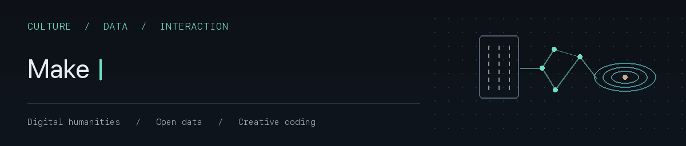
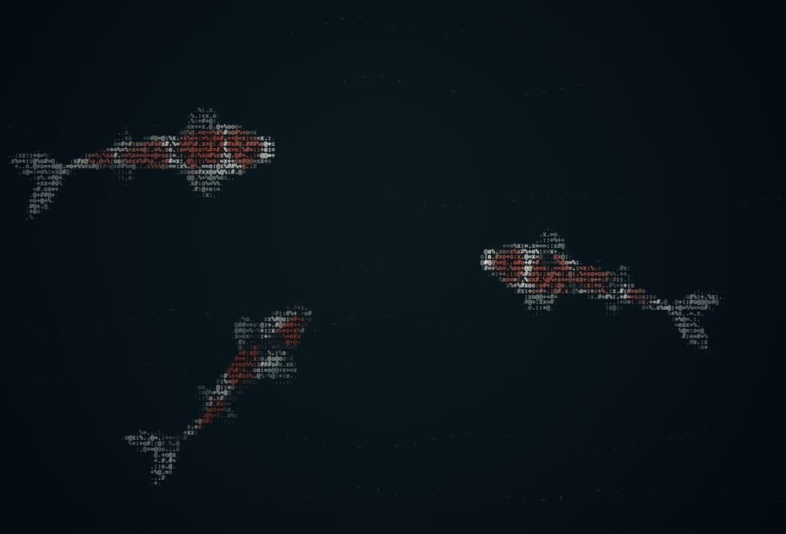
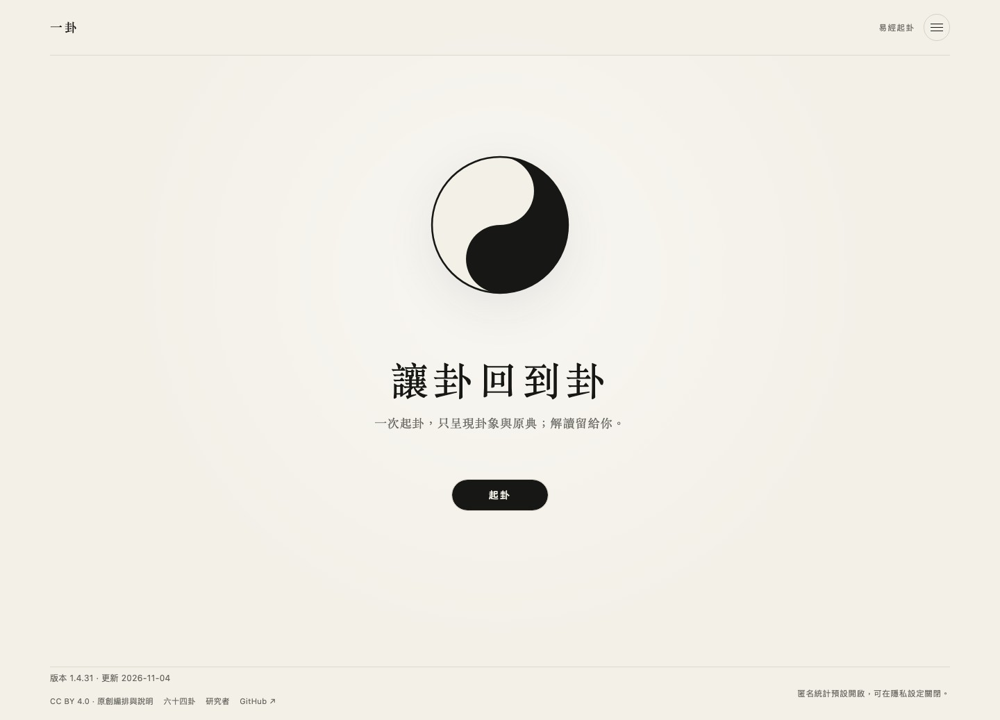

# Chen-Yu Chu · 曲宸宇

<picture>
  <source media="(prefers-reduced-motion: reduce)" srcset="assets/focus-static.png">
  
</picture>

Medical student in Taiwan exploring **cultural heritage, open data, and creative coding**—turning source material and ideas into things people can read, use, and build on, with AI as a collaborator.

我是臺灣的醫學生，探索 **文化材料、開放資料與互動創作**，透過 AI 協作將原始資料與想法做成他人可以閱讀、使用與延伸的作品。

[一卦 Yigua](https://yigua.art/) · [ORCID](https://orcid.org/0009-0003-9738-6914) · [All projects｜全部專案](https://github.com/poplolioi11?tab=repositories)

## Selected work｜代表作品

### Research & open data｜研究與開放資料

| Project｜專案 | What you can use｜可使用的成果 |
| --- | --- |
| [Late Qing medical-history texts｜晚清醫學史文獻](projects/medical-history.md) | Ten source-linked Bodleian texts on medicine and medical charity, with TXT/JSON/TEI, uncertain readings, and versioned citations. 十件 Bodleian 醫學與醫療慈善史文獻，提供 TXT／JSON／TEI、疑讀與版本引用。 [Explore all 10 repositories｜查看十個儲存庫](projects/medical-history.md) |
| [Taiwan Public Library Statistics｜臺灣公共圖書館統計](https://github.com/poplolioi11/tw-public-library-statistics) | Explore charts and CSV/SQLite datasets traceable to official sources. 查閱圖表與 CSV／SQLite 資料，逐筆回官方來源。 [Open explorer｜開啟圖表](https://poplolioi11.github.io/tw-public-library-statistics/) |
| [Taiwan Public Museum Conservation Index｜臺灣公立館保存修護索引](https://github.com/poplolioi11/tw-public-museum-conservation) | Find published conservation records with source and coverage notes. 查找保存修護公開紀錄，保留來源、涵蓋範圍與缺口。 [Explore records｜查閱原報](https://poplolioi11.github.io/tw-public-museum-conservation/) |
| [Sitian Kaoyantu｜司天考驗圖](https://github.com/poplolioi11/ms-chin-c25-sitian-kaoyantu) | An AI-assisted draft transcription with image review, uncertain readings, and versioned files. 古籍 AI 輔助初錄與回圖校讀，保留疑讀與版本紀錄。 |

### Interactive experiences｜互動體驗

<table>
<tr>
<th width="50%"><a href="https://github.com/poplolioi11/gosanke-koi">Gosanke Koi｜御三家錦鯉</a></th>
<th width="50%"><a href="https://yigua.art/">Yigua｜一卦</a></th>
</tr>
<tr>
<td width="50%" valign="top">

Three ASCII koi moving through a dark pond. 三隻字元錦鯉在深墨藍水域悠游。

<a href="https://poplolioi11.github.io/gosanke-koi/">Live demo｜直接試看</a> · <a href="https://github.com/poplolioi11/gosanke-koi">Source｜原始碼</a>

</td>
<td width="50%" valign="top">

An I Ching experience rooted in hexagrams and source texts, with an interface in eight languages. 以卦象與原典為核心的《易經》數位體驗，提供八語介面。

<a href="https://yigua.art/">Open Yigua｜開啟一卦</a> · <a href="https://www.cssdesignawards.com/sites/yi-gua/50511/">CSS Design Awards — Special Kudos · Final Judge’s Score 7.27</a> 2026-10-27 · CSS Design Awards：Special Kudos、評審分數 7.27；UI／UX／Innovation Public Awards。

</td>
</tr>
</table>

More cultural projects｜更多文化作品

- [Yigua Minecraft｜一卦 Minecraft](https://github.com/poplolioi11/yigua-minecraft) — Exploring cultural interaction in a game world.｜探索遊戲中的文化互動。
- [Wuyingdian I Ching lines｜武英殿本《周易》爻辭](https://github.com/poplolioi11/yigua-wuyingdian-lines)
- [Lunyu Xiangdang Tujie｜論語郷黨圖解](https://github.com/poplolioi11/kyoto-rb00009915-lunyu-xiangdang-tujie-1812)

## Current focus｜目前方向

- **Digital humanities & medical history｜數位人文與醫學史** — Traceable historical-text datasets. 整理可追溯的古籍與醫學史文獻，保留底本來源、疑讀與修訂紀錄。
- **Open cultural data｜文化開放資料** — Source-linked library and museum records from Taiwan. 整合臺灣圖書館統計與博物館保存修護公開資料，提供可用資料與回查入口。
- **Creative coding｜互動視覺創作** — Water, creatures, ASCII, and cultural experiences in the browser. 探索水景、生物與字元動畫，並透過「一卦」製作文化互動體驗。
- **Personal AI workflows｜個人 AI 工作流** — Background workflows for research, making, and review. 建立研究、製作與查核用的個人 AI 工作流。

## How I work｜我怎麼做

**Human-led direction, AI-assisted research and implementation.** I focus on defining problems, making editorial and design decisions, and reviewing and integrating results. Sources, versions, and limitations stay visible.

**由人決定方向，透過 AI 協助研究與實作。** 我著重問題定義、內容與美術取捨，以及成果判斷和整合，並保留來源、版本與尚待驗證的部分。

Historical-text projects include AI-assisted drafts and image-based review; they are **not human expert-verified editions**. Data coverage, rights, and validation are documented per project.

古籍專案包含 AI 輔助初錄與回圖校讀，**尚非人類專家審定本**；資料涵蓋範圍、權利與驗證狀態，均以各專案說明為準。

Community contributions｜社群貢獻

Selected submitted pull requests; status checked 2026-11-05.｜已送出的代表性 PR；狀態核對於 2026-11-05。

| Contribution｜貢獻 | Status｜狀態 |
| --- | --- |
| [Carbon #23847 — Pagination overflow translations](https://github.com/carbon-design-system/carbon/pull/23847) 將翻譯回呼傳入分頁溢出控制，補上文件與回歸測試。 | Open｜審查中 |
| [Adobe Spectrum #6862 — CJK status-light line height](https://github.com/adobe/spectrum-web-components/pull/6862) 讓中日韓標籤套用自訂行高並保留預設值。 | Open｜審查中 |
| [SAP #6431 — Accessible progressbar names](https://github.com/SAP/fundamental-styles/pull/6431) 為文件範例的進度列補上無障礙名稱。 | Open｜審查中 |

I also document reproducible Traditional Chinese / CJK interface issues, including [Carbon’s translated labels](https://github.com/carbon-design-system/carbon/issues/23846) and [Adobe Spectrum’s locale-sensitive line height](https://github.com/adobe/spectrum-web-components/issues/6861). These links record issue reports; resolution status belongs to each upstream project.

我也整理繁體中文與 CJK 介面中可重現的問題，包括 [Carbon 翻譯標籤](https://github.com/carbon-design-system/carbon/issues/23846)與 [Adobe Spectrum 語系行高](https://github.com/adobe/spectrum-web-components/issues/6861)；這些連結為問題回報，修正狀態以各上游專案為準。

## Certifications｜認證

| Credential｜證書 | Issued｜取得日期 |
| --- | --- |
| [**Hugging Face Deep Reinforcement Learning Course — Certificate of Excellence**](https://github.com/poplolioi11/poplolioi11/blob/main/assets/certificates/huggingface-deep-rl-excellence-2026-11-05.pdf) 深度強化學習課程優秀結業證書 · Hugging Face · [官方紀錄｜Official record](https://huggingface.co/datasets/huggingface-projects/Deep-RL-Course-Certification/blob/7eea1febf8fdc6533b2d5092fa29b4eea35e4b20/certified_users.csv#L2) | 2026-11-05 |
| [**Hugging Face Agents Course — Certificate of Excellence**](https://huggingface.co/datasets/agents-course/final-certificates/resolve/main/certificates/poplolioi11/2026-11-04.png) AI Agents 課程優秀結業證書 · Hugging Face | 2026-11-04 |
| [Gemini Certified University Student](https://edu.google.accredible.com/89146706-ac8b-448e-8b65-49f61c4e0b6f) Google for Education · Valid until｜有效至 2029-10-24 | 2026-10-24 |

Other course & unit certificates (10)｜其他課程與單元證書（10）

| Credential｜證書 | Issued｜取得日期 |
| --- | --- |
| [Kaggle — Intermediate Machine Learning](https://www.kaggle.com/learn/certification/poplolioi11/intermediate-machine-learning) 中階機器學習 · Certificate of Completion｜課程完成證書 | 2026-11-05 |
| [Kaggle — Feature Engineering](https://www.kaggle.com/learn/certification/poplolioi11/feature-engineering) 特徵工程 · Certificate of Completion｜課程完成證書 | 2026-11-05 |
| [Kaggle — Intro to Deep Learning](https://www.kaggle.com/learn/certification/poplolioi11/intro-to-deep-learning) 深度學習入門 · Certificate of Completion｜課程完成證書 | 2026-11-05 |
| [Kaggle — Computer Vision](https://www.kaggle.com/learn/certification/poplolioi11/computer-vision) 電腦視覺 · Certificate of Completion｜課程完成證書 | 2026-11-05 |
| [Hugging Face Reasoning Course — Fundamentals of GRPO](https://huggingface.co/datasets/reasoning-course/certificates/resolve/b9406b240434c33308fd290121381b9588a3f94d/certificates/poplolioi11/2026-11-05.png) 推理課程：GRPO 基礎 · Certificate of Achievement｜單元成就證書 | 2026-11-05 |
| [Hugging Face LLM Post Training — Supervised Fine-tuning](https://huggingface.co/datasets/smol-course/certificates/resolve/5d353065096d1385e652ef05d19ff5f59315f8f9/certificates/poplolioi11/2026-11-05.png) LLM 後訓練：監督式微調 · Certificate of Achievement｜單元成就證書 | 2026-11-05 |
| [Hugging Face LLM Post Training — Preference Alignment](https://huggingface.co/datasets/smol-course/certificates/resolve/f916ff1d4f2c6e274f3377fc536b4ec8f72dad57/certificates/poplolioi11/2026-11-05.png) LLM 後訓練：偏好對齊 · Certificate of Achievement｜單元成就證書 | 2026-11-05 |
| [Hugging Face LLM Post Training — Vision Language Models](https://huggingface.co/datasets/smol-course/certificates/resolve/cdd466e2234c92dad6957225cada778dd164735a/certificates/poplolioi11/2026-11-05.png) LLM 後訓練：視覺語言模型 · Certificate of Achievement｜單元成就證書 | 2026-11-05 |
| [Hugging Face MCP Course — Unit 1: Fundamentals of MCP](https://huggingface.co/datasets/context-course/certificates/resolve/fae7fc6341f03574011524c4f6082d0b68de3bed/certificates/poplolioi11/2026-11-04.png) MCP 單元 1：MCP 基礎 · Certificate of Achievement｜單元成就證書 | 2026-11-04 |
| [Hugging Face MCP Course — Unit 3: MCP for Production Automation](https://huggingface.co/datasets/context-course/certificates/resolve/4fde36b10449e46a55756e492674a12533be2cb1/certificates/poplolioi11/2026-11-04.png) MCP 單元 3：正式環境自動化 · Certificate of Achievement｜單元成就證書 | 2026-11-04 |

Hugging Face and Kaggle coursework and assessments were AI-assisted.｜Hugging Face 與 Kaggle 課程實作及測驗採用 AI 協助。

If a project is useful to you, a star helps you find it again. Feedback and thoughtful adaptations are welcome. 
若作品對你有幫助，歡迎加星收藏，也歡迎回報使用經驗或延伸改作。
